<div align="center">

# Vermilion (collab)

[中文](README.md) · **English**

**AI drafts, you decide.**

Organize Claude, Codex and DeepSeek into a small team that carries a real, weeks-long project for you.<br>
You do three things: set the goal, approve the plan, and make the call when it matters.

**[Website collab.hongyangz.top/en](https://collab.hongyangz.top/en/)** · **[Open the demo board](https://collab.hongyangz.top/demo/en/ch8/p/15730301/)** · **[Start from Chapter 1](https://collab.hongyangz.top/demo/en/)**

[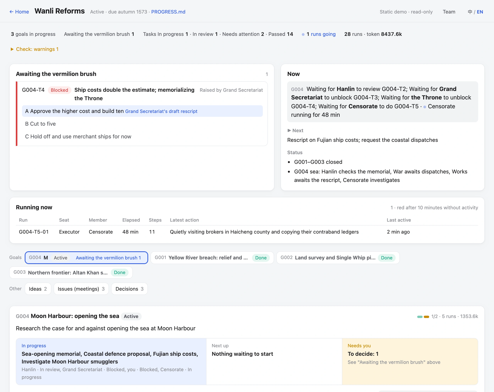](https://collab.hongyangz.top/demo/en/ch8/p/15730301/)

<sub>One screen: what needs your decision, who is doing what, and which runs are going. The animated, interactive version is on the website.</sub>

</div>

---

## 1. Claude and Codex manage conversations. Vermilion manages the work.

Use Claude or Codex directly to push a weeks-long project and you soon become the messenger:

- **Relay**: one model writes the plan, you paste it to another to write the code, then paste the result back for review.
- **Amnesia**: a new session means retelling the background. What you settled yesterday is gone today.
- **Self-grading**: the same model plans, builds and signs off. Nobody else ever looks.

The models are strong enough. The problem is structure: they are organized as **project → conversations**; Vermilion is **project → goals → tasks**.

**Claude / Codex: project → conversations.** Conclusions are scattered across chat logs. Who did what and how far it got: only you remember.

```
My project
├─ 💬 Help me plan a login feature
├─ 💬 Write the code for this plan (copied from the last chat)
├─ 💬 Let's pick up from yesterday… (background retold)
└─ 💬 Can you check it for problems again?
```

**Vermilion: project → goals → tasks.** Every card says what's wanted, who does it, who checks it and how far it got. Switch models or sessions and work picks up from "▶ Next".

```
My project
├─ G001 Ship login                              [Approved]
│  ├─ T1 Plan               Claude does · Codex reviews   [Passed]
│  ├─ T2 Code               Codex does · Claude checks    [In progress]
│  └─ T3 End-to-end check   DeepSeek checks               [Not started]
└─ G002 Redesign home page                      [Awaiting approval]
```

| | Claude / Codex directly | With Vermilion |
|---|---|---|
| Unit of work | A conversation | A goal, split into task cards |
| Planning and staffing | How to split it and who gets what is all on you | The Lead builds the plan and picks members by capability; you approve once and work starts |
| Workspace | Output scattered in chats, drafts mixed with finished work | `collab/` is the ledger, `work/` holds results: one delivery per task, one desk per member |
| Memory across sessions | Stuck in chat history; retell it every time | Written in `collab/`: one shared picture for every model, picking up from "▶ Next" |
| Several models together | You copy and paste between windows | The Lead dispatches; members work in their own CLIs; results are logged automatically |
| Who comes to you | Every model, after every step | The Lead handles members and solves what the plan covers; only real blockers reach you, with options and a recommendation |
| Multi-model discussion | You ask each in turn and relay their answers | Meetings: each speaks independently and reviews the plan, you rule, and the transcript is kept |
| Who says it's done | The model that did it | Another model checks it against the success criteria and sends it back if it falls short |
| What you manage | Every step | Three things: approve the plan, decide "Needs your decision", confirm completion |
| Progress and cost | Scroll through chats | The board shows it at a glance: who's working, what's stuck, how many tokens |

## 2. An answer from four centuries ago

In Ming China, the Grand Secretariat drafted a response to each memorial on a slip of paper, and the Emperor only decided, in vermilion ink. The ministries carried it out; the censors checked. Vermilion gives AI assistants the same division of labour:

| Seat | Ming court | Who sits there | What they do |
|---|---|---|---|
| **Owner** | The Emperor's vermilion brush | **You** | Set goals, approve plans, rule on "Needs your decision" |
| Lead | Grand Secretariat drafts | Your main assistant (e.g. Claude) | Break down goals, design the flow, dispatch, integrate results |
| Members | The Six Ministries | Codex, DeepSeek… | Do tasks in their own native CLI |
| Reviewer | Supervising secretaries | A different model | Check against the success criteria; send back what falls short |

The roster records each model's tier and cost: hard work goes to strong models, tidying and lookups to cheap ones. Within a goal, members resume their earlier sessions where possible instead of starting from zero.

## 3. How one piece of work gets done

From a one-line idea to sign-off and archive in eight steps, and you appear in only three. The Lead and members carry the rest and come to you only when they're stuck.

| Step | Who | What |
|---|---|---|
| 1 Idea | **You** | Say what you want in a line |
| 2 Proposal | Lead | Big calls go to a meeting |
| 3 Plan | Lead | Tasks and who does them |
| 4 Approve | **You** | No work before approval |
| 5 Work | Members | Members deliver into `work/` |
| 6 Cross-check | Members | Another model reviews; failures go back |
| ↳ Needs your decision | **You** | Only when stuck, with options, costs and a recommendation |
| 7 Report | Lead | Integrate results; goal goes up for sign-off |
| 8 Confirm | **You** | You nod; it's archived |

## 4. A real case: what happens when work gets stuck

Every image below is taken from the demo, "The Wanli Reforms". Click one to jump to that moment on the board.

**1. Blocked, and the Grand Secretariat handles it.** Works reports that closing the breach needs both stone and labourers, and it can only supply the stone. The Grand Secretariat sees this is within the plan and doesn't trouble the Throne: it splits the work into quarrying (Works) and levying labour (Revenue) in parallel, and the original task becomes pulling the two together. The flow chart marks how this differs from the approved version.

[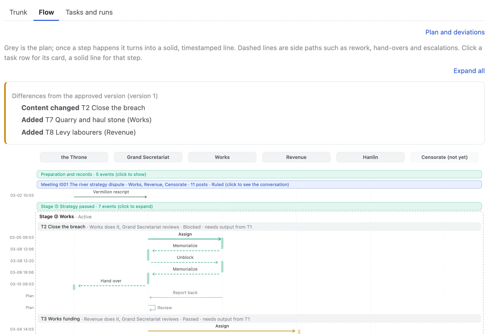](https://collab.hongyangz.top/demo/en/ch3/p/15730301/?view=flow#G001)

**2. Only what it can't solve comes to you.** Then Works is 100,000 taels short and the Grand Secretariat has nowhere to borrow from, so it goes up to the Throne: three options, the cost of each, and the Secretariat's draft rescript. One stroke of vermilion and work continues.

[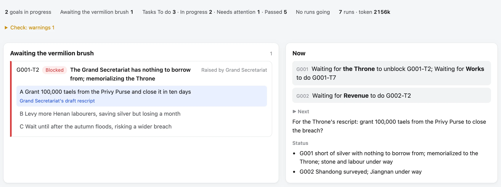](https://collab.hongyangz.top/demo/en/ch3/p/15730301/#G001)

**3. A meeting: three rounds from dispute to compromise.** The river strategy dispute. Round one: Works, Revenue and the Censorate each state a position independently. Round two: they question each other; Revenue asks where the silver comes from, and Works brings up three diversions under Jiajing that all broke again. Round three: one follow-up question from you, and Works proposes building the dykes over two years. The Secretariat sums up and you rule.

[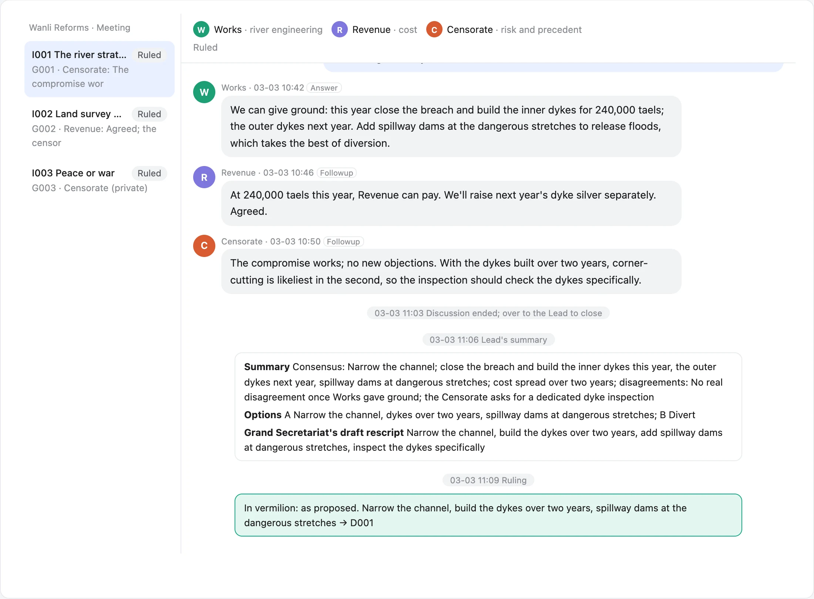](https://collab.hongyangz.top/demo/en/ch1/p/15730301/meet/I001/)

**4. Dissent on record, and a private word just for you.** War or peace with the Mongols. War revises its plan using Works' numbers, and Revenue works out the savings over three years. The Censorate accepts the limits but insists its dissent go into the memorial word for word, and privately warns that the horse counts may not be reliable. Only you and the Grand Secretariat can see that note.

[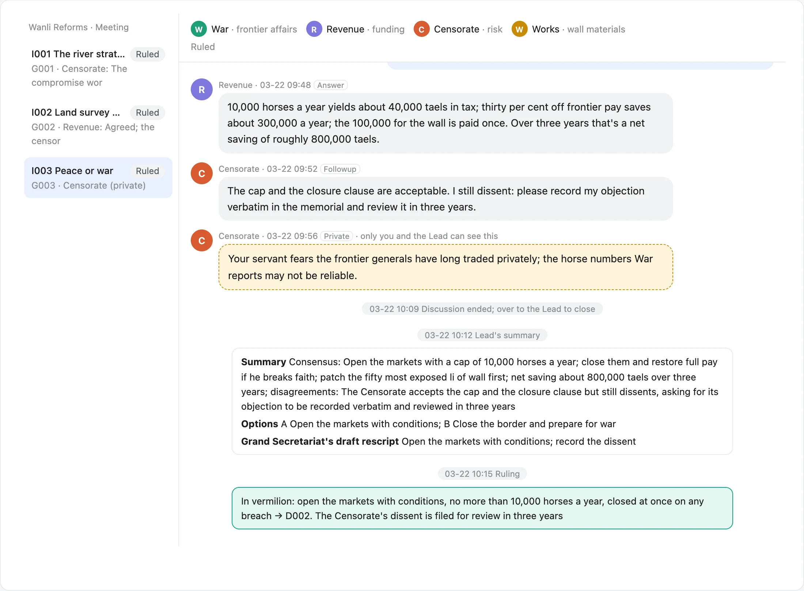](https://collab.hongyangz.top/demo/en/ch5/p/15730301/meet/I003/)

**5. Who is doing what, at a glance.** Five sea-opening tasks in parallel: Hanlin is reviewing Revenue's memorial, War and Works are blocked (the ship costs have gone up to you), and a Censorate run is going. Solid lines go out, dashed lines come back, and colour is state.

[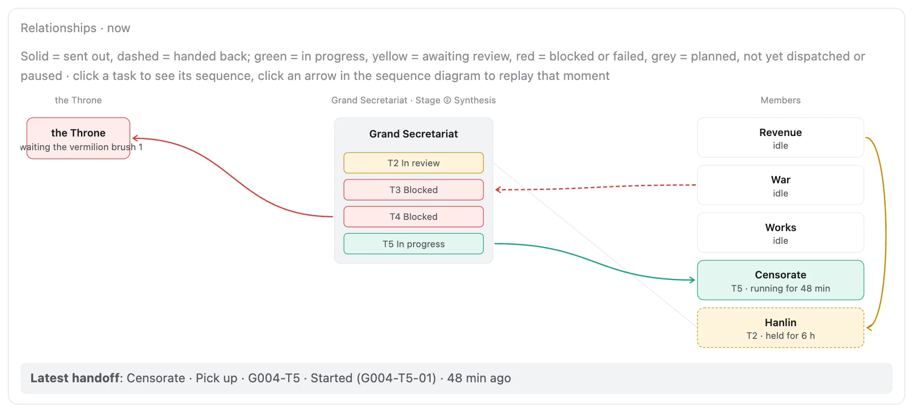](https://collab.hongyangz.top/demo/en/ch8/p/15730301/?view=flow#G004)

## 5. What's inside

Every screen on the board is generated on the spot from the project's Markdown and event log.

| | |
|---|---|
| [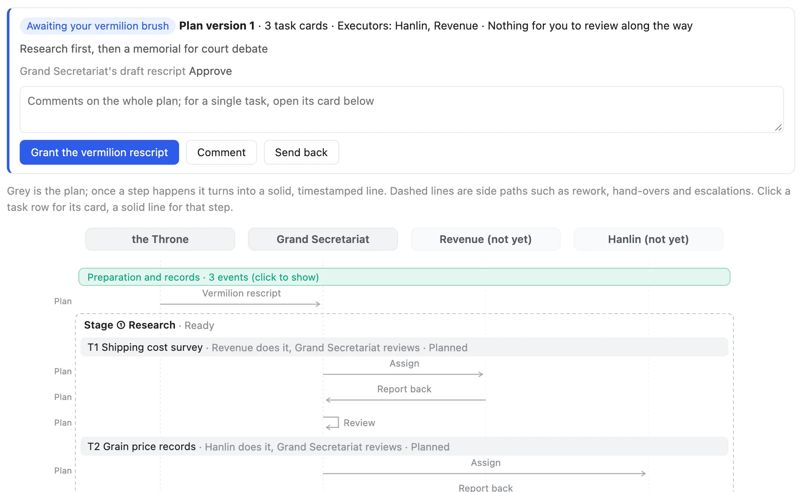](https://collab.hongyangz.top/en/#features)<br>**See the whole plan before you approve**<br>Once a plan is submitted, the board shows it as one diagram. Comment on it or send it back; work starts only when you click approve. The approved version is saved, and from then on the diagram marks where reality departs from it. | [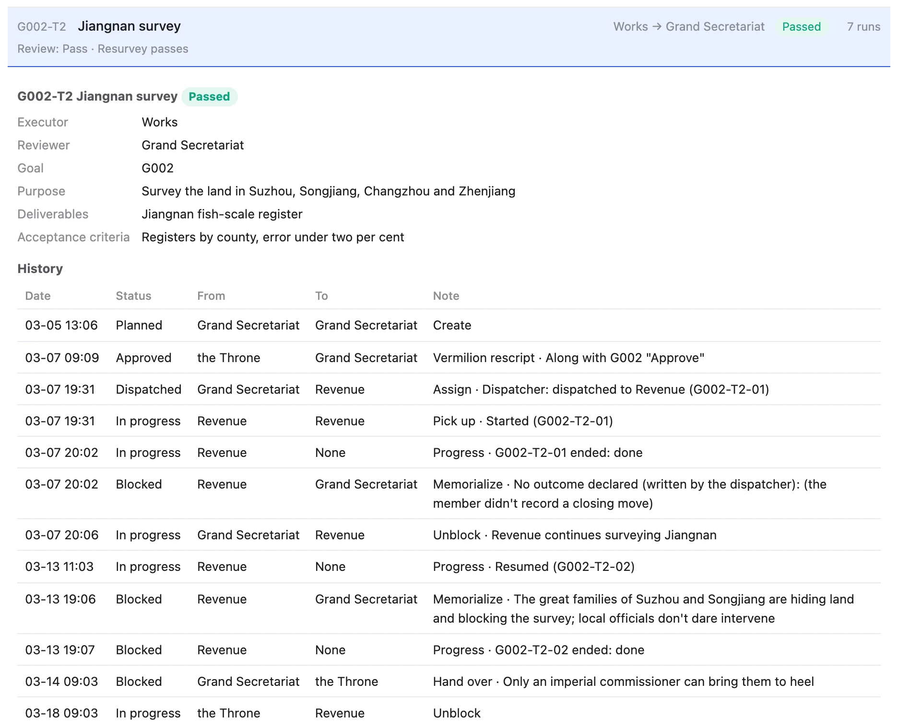](https://collab.hongyangz.top/demo/en/ch7/p/15730301/#G002)<br>**Every task card has its full history**<br>Purpose, deliverables and acceptance criteria live on the card. Who dispatched it, who took it, when it got blocked, why it went up, which session was resumed: each step is a row in the history. |
| [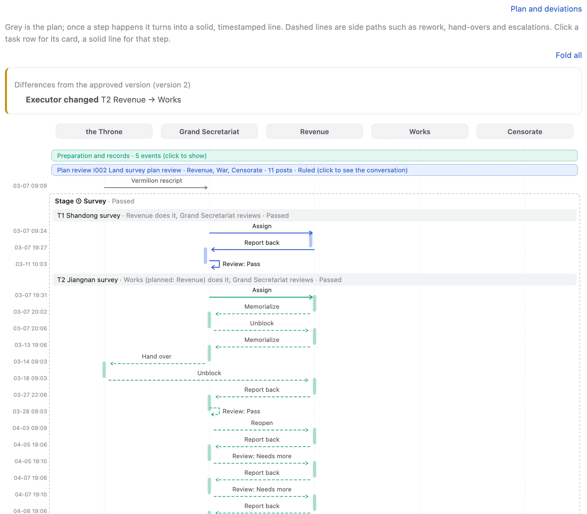](https://collab.hongyangz.top/demo/en/ch7/p/15730301/?view=flow#G002)<br>**Sequence diagram: plans become solid lines, with every rework on it**<br>When evidence overturns a premise the goal is reopened and later stages fall away; after two more failed attempts the rework limit is hit and the Secretariat reassigns the job. | [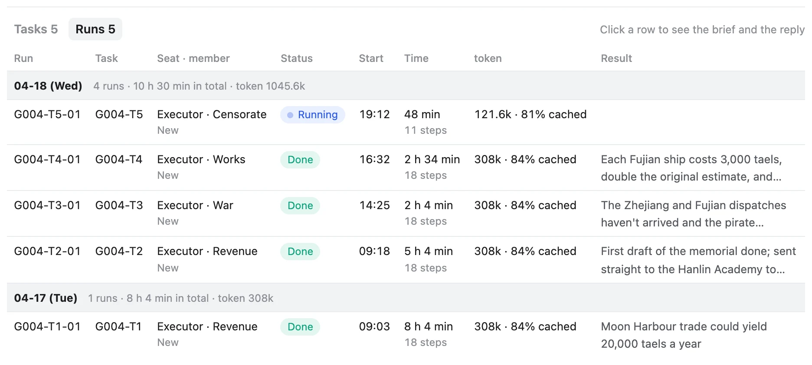](https://collab.hongyangz.top/demo/en/ch8/p/15730301/#G004)<br>**Every run: time, steps, tokens**<br>The dispatch script starts members, resumes sessions and keeps the books: which run is going, how long it's taken, tokens spent, and the one line it reported back, totalled by day. |
| [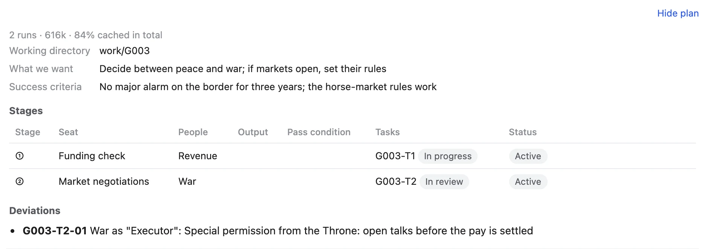](https://collab.hongyangz.top/demo/en/ch5/p/15730301/?view=flow#G003)<br>**You can step outside the process, but it leaves a trace**<br>In special cases the order can be overridden, but a reason must be given and the board marks it as a deviation. Starting work without approval is the one rule nobody can override. | [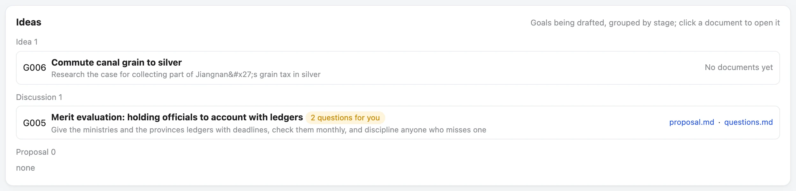](https://collab.hongyangz.top/demo/en/ch8/p/15730301/#ideas)<br>**Every idea gets a card first**<br>Mention a new reform in passing and the Lead opens a card for it. Drafts are grouped by idea, discussion and proposal, and don't take up an active slot. |

**The rules are enforced by code, not by AI good behaviour.** Every state change goes through `flow.py`, which checks order, staffing, dependencies and approval and refuses anything out of line on the spot. If validation fails or a hand-off is missing, the dispatch script won't send the work. Claude Code runs validation at the end of every turn and won't let the turn end with errors.

```text
$ flow.py log G006-T1 dispatch --to Revenue --override "urgent"
hard error: G006-T1 is still planned: work starts once goal G006 is approved. This can't be overridden

$ flow.py log G004-T3 dispatch --to War
rule error: G004-T3 is "Blocked" and can't take "Dispatch" (only from Approved)
If the Lead or Owner really needs this, add --override "reason"; the board will mark it as a deviation.
```

**Also:** just local files: your project gains a `collab/` folder of Markdown and JSON, managed by git, with no database, account or cloud service. Decisions get their own register, and meeting rulings are recorded automatically. Finished goals move to the archive page. An optional NOW board puts several projects and your schedule on one page. Members work in their own CLIs (Claude Code, Codex CLI and others); Vermilion doesn't rewrite the agents.

## 6. The Wanli Reforms: an eight-chapter demo

Nothing to install. The demo is set in 1573, the first year of the Wanli Emperor, and you are the Emperor. Each chapter is the real board of one project stopped at a moment in the story, and every event goes through the toolkit's real write path. The data is fictional: nothing was dispatched and no model was called. It is also the toolkit's largest regression test.

| Chapter | What to look at |
|---|---|
| [Ch. 1 · Approve first, then work](https://collab.hongyangz.top/demo/en/ch1/p/15730301/#G001) | No plan, no work; the relief edict is redrafted four times |
| [Ch. 2 · Several models review the plan](https://collab.hongyangz.top/demo/en/ch2/p/15730301/meet/I002/) | The Censorate's objection changes the plan; the Secretariat splits a task |
| [Ch. 3 · Only the decisions that need you](https://collab.hongyangz.top/demo/en/ch3/p/15730301/#G001) | 100,000 taels short: options, costs and a draft rescript |
| [Ch. 4 · After the rescript, work resumes](https://collab.hongyangz.top/demo/en/ch4/p/15730301/#G002) | The memorial disappears and Works carries on; Jiangnan blocks the survey |
| [Ch. 5 · A meeting you chair](https://collab.hongyangz.top/demo/en/ch5/p/15730301/meet/I003/) | Adding a minister mid-debate, a private word; a plan sent back; a deviation |
| [Ch. 6 · Done only after a third-party check](https://collab.hongyangz.top/demo/en/ch6/p/15730301/#G001) | The Censorate inspects; the river works close |
| [Ch. 7 · Evidence overturns a premise; the flow rolls back](https://collab.hongyangz.top/demo/en/ch7/p/15730301/#G002) | Later stages fall away; rework limit hit, Works brought in |
| [Final · Who is doing what, at a glance](https://collab.hongyangz.top/demo/en/ch8/p/15730301/#G004) | Five sea-opening tasks in parallel; new ideas get cards first |

The story and what each chapter shows are in [demo/script.en.md](demo/script.en.md).

## 7. The next way of working with AI

Today we chat with AI one message at a time. What we want: you talk to one Lead about what you want, and it organizes the people, drives the work and delivers.

1. **Goals as the unit; you stay at the top.** Every project starts from goals. With the Lead you discuss what you want, the success criteria and the trade-offs, then review the delivery and sign off. Breaking down tasks, staffing, tracking and rework are the Lead's job.
2. **A talent market: proven setups as specialists.** A setup that you or others have used and proven again and again, covering persona, skills, MCP tools, permission limits, strengths, tier and cost, and track record, packaged as a "specialist" that can be shared and reused.
3. **The Lead assembles a team per goal.** Once a goal is set, the Lead picks suitable specialists from the market: strong ones for hard work, cheap ones for chores, plus a critical reviewer. When the work is done the team disbands, and good specialists earn a reputation.

**Where it stands:** the main line of goals, tasks, approval, dispatch, review and meetings already works (it's the demo above). Team configuration works, and the board has an early talent market, still on sample data. Packaging, sharing and reputation for specialists come next.

## 8. Get started

You need Python 3 (standard library only) and git. It currently runs on macOS.

**Try the demo locally** (after cloning this repository, from its root):

```bash
python3 demo/build.py --lang en
python3 src/board/server.py --port 3101 --project demo/wanli-reforms
```

Open http://127.0.0.1:3101. On the local board you can really approve and speak in meetings.

**Use it on your own project (three core steps):**

```bash
src/core/publish.sh ~/vermilion/system                       # 1. publish the toolkit as a standalone copy
bash ~/vermilion/system/board/service.sh install             # 2. keep the board running (port 3100)
cd <project dir> && ~/vermilion/system/core/init.sh new --lang en   # 3. install the workbench (AGENTS.md + collab/)
```

The project registers itself with the board, and http://127.0.0.1:3100 lists every project. Then have the Lead open your first goal from `collab/PROGRESS.md`. For the NOW board, dispatch and team configuration, see "Quick start" in [src/README.en.md](src/README.en.md).

```
src/      the toolkit: flow engine flow.py, dispatch script, validator, board server, the workbench installed into projects
tests/    tests and expected output
demo/     the demo "The Wanli Reforms": script, generator, static site export
```

Full test suite: `python3 -m unittest discover -s tests`.

## 9. FAQ

<details><summary><b>Which models does it support?</b></summary>

The Lead is usually Claude (Claude Code or the desktop app). Members can be Codex CLI, DeepSeek, the Claude CLI, or any assistant that runs in a terminal. Members work in their own native CLI; Vermilion doesn't replace them.
</details>

<details><summary><b>Where is my data? Is anything uploaded?</b></summary>

Everything lives in your project's `collab/` and `work/` folders as Markdown and JSON, and the board runs on your machine. Vermilion itself uploads nothing; the models go online however their own tools do.
</details>

<details><summary><b>What does it cost?</b></summary>

Vermilion is free and open source (MIT). The cost is the models you use: the board records tokens and cache hits for every run, and the Lead picks members by difficulty and price, giving chores to cheaper models.
</details>

<details><summary><b>How is this different from a multi-agent framework?</b></summary>

Multi-agent frameworks orchestrate agents talking to each other in code. Vermilion doesn't write agents or script conversations. It manages the project ledger, the flow, approvals and sign-off, and the agents are the CLI tools you already have.
</details>

<details><summary><b>Which languages does it support?</b></summary>

English and Chinese. You choose when you install the workbench in a project (`--lang en` or `--lang zh`); protocol, templates and messages follow that choice, and `init.sh lang en|zh` switches an existing project. File names and codes underneath are English for both. The board has its own 中 / EN switch.
</details>

<details><summary><b>Which operating systems?</b></summary>

So far it has only been used on macOS. It needs Python 3 (standard library only) and git.
</details>

<details><summary><b>Should I use it for small things?</b></summary>

No. For a one-off question, just chat. Vermilion suits work that runs for days or weeks, moves in stages, and benefits from models checking each other.
</details>

## This is still a demo

Vermilion is an early version and needs more work before it fully delivers on the ideas above. Share your own "team": which models you use, how you split the work, which specialist works best. Ideas for improvement and complaints are welcome too.

- Email: [hongyang003@e.ntu.edu.sg](mailto:hongyang003@e.ntu.edu.sg)
- Or open an issue or PR

## Status and licence

Early version: interfaces and file formats will still change, and a single `collab` command is in progress. Docs come in English and Chinese. [MIT](LICENSE) licence.
