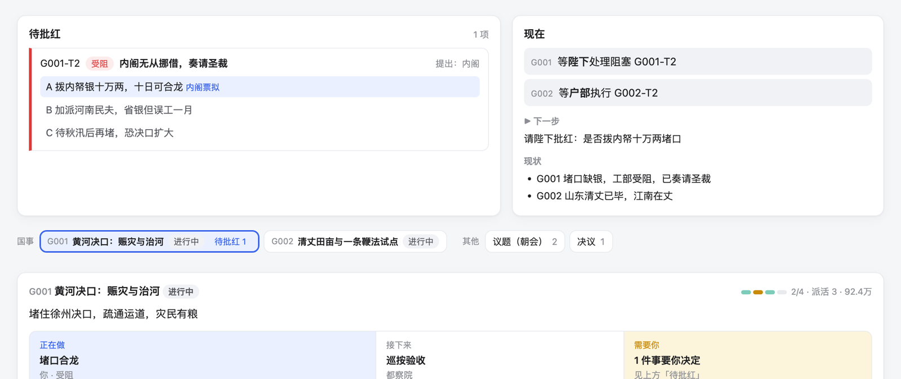
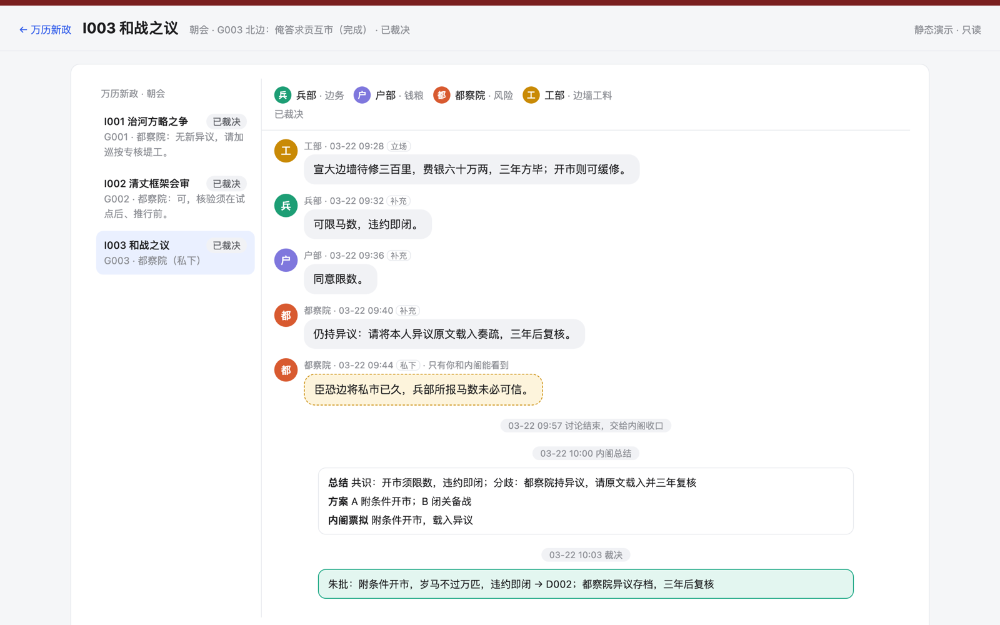
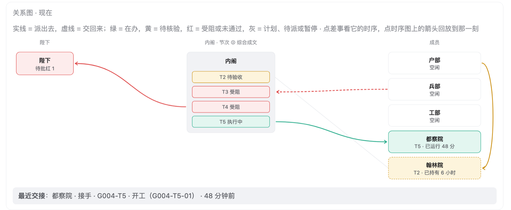
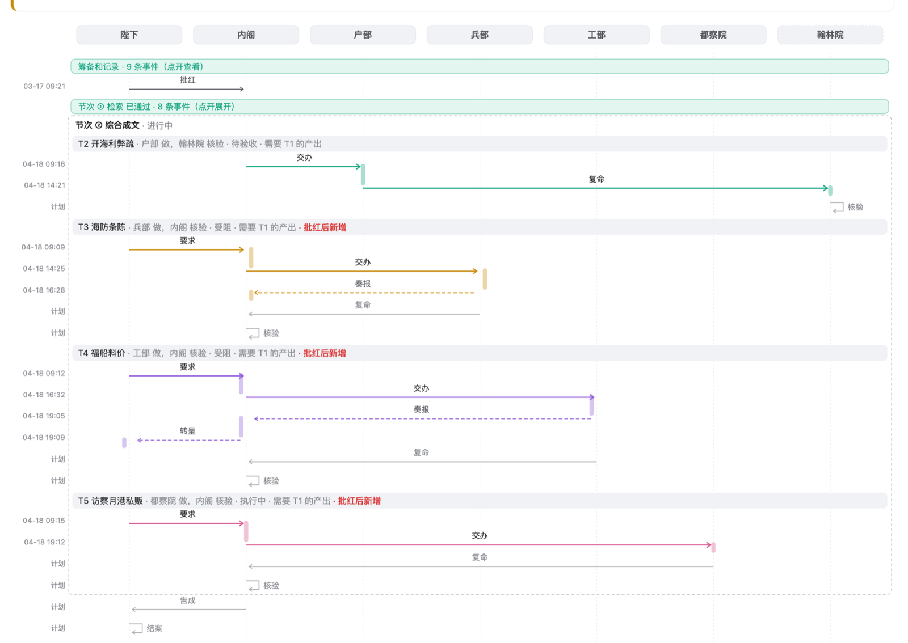

# 批红（collab）

**AI 票拟，你来批红。**

把 Claude、Codex、DeepSeek 这些 AI 助手组织成一个小班子，替你推进持续几周的真实项目。你只做三件事：定目标、批准方案、在关键处拍板。拆任务、派活、执行、互相验收由它们来做；进度写进项目里的 Markdown 文件，在本机看板上一目了然。

**[→ 在线看演示「万历新政」](https://zhanghongyang857-dot.github.io/collab/)**：不用安装，八回剧情，每一回都是同一个项目停在某一刻的真实看板。



---

## 一、你成了传话筒

和 AI 一起做一件持续几周的事，很快会遇到这些麻烦：

- 让 Claude 出方案，再复制给 Codex 去写代码，再把结果贴回来给 Claude 看。**你在几个窗口之间传话。**
- 换一个会话，背景又要从头讲一遍；昨天谈定的事，今天的会话不知道。
- 同一个模型自己出方案、自己执行、自己说「做完了」，**没有第二双眼睛**。
- 你被拖进每一个细节，分不清哪件事真的需要你决定。
- 做到哪了、卡在哪、花了多少 token，只能翻聊天记录。

几个模型各自都很强，缺的是一套**分工、交接和把关**的制度。

## 二、四百多年前的答案

明朝处理政务有一套成熟的分工：

- **票拟**：内阁先替皇帝读奏章、拟好处理意见，写在小票上；
- **批红**：皇帝用朱笔批「可」或「否」，只做决定；
- **六部执行**，**给事中、御史封驳**：诏令不妥可以退回，执行结果要有人核验。

皇帝不必懂河工和钱粮，但每件大事的方向都握在他手里。批红就是把这套分工搬到 AI 身上：

| 席位 | 明朝 | 谁来坐 | 做什么 |
|---|---|---|---|
| 总裁 | 皇帝批红 | **你** | 定目标、批准框架、在「待你决定」里拍板 |
| 总管 | 内阁票拟 | 一个主力助手（如 Claude） | 拆目标、搭流程、派活、协调、整合成果 |
| 成员 | 六部 | 按任务挑选（Codex、DeepSeek……） | 在自己的原生命令行里，在授权范围内完成任务 |
| 验收 | 给事中封驳 | 总管或另一个模型 | 对照成功标准核验，不达标就退回 |

## 三、万历新政：八回演示

演示项目设在万历元年，你是皇帝。黄河在徐州决口，清丈、北边、开海三件大事接踵而来。内阁（总管）立案、拟流程，工部、户部、兵部、都察院、翰林院（成员，分别由 Codex、DeepSeek、Claude 命令行扮演）分头办差。看板上的叫法换成了明朝说法（待你决定 → 待批红，目标 → 国事，任务 → 差事），数据和真实使用时完全一样。

> 全部是虚拟数据：没有真的派活，也没有调用模型。但每一条事件都走工具包真实的写入路径，过同一套规则检查。所以它既是演示，也是工具包最大的一组回归测试。

下面每一回演示一个功能，点链接直接看那一刻的看板。

### 第一回　河决徐州：先批准，再开工 · [看第一回](https://zhanghongyang857-dot.github.io/collab/ch1/p/15730301/#G001)

内阁立案「黄河决口」，先经过讨论和方案两个起草阶段，再拟出流程框架进呈：方略、施工（堵口、钱粮两路并行）、赈济、巡按验收。**框架没有批红，谁都不能开工**，这一条程序不让越过。陛下批红时顺手加了一道都察院验收，第三方验收节次就自动追加上去。

同一回里，陛下亲交翰林院拟赈灾诏，**四易其稿**才准颁行：你也可以直接派活、直接验收。

### 第二回　清丈议起：多个模型会审你的框架 · [看会审对话](https://zhanghongyang857-dot.github.io/collab/ch2/p/15730301/meet/I002/)

清丈框架进呈前，户部、兵部、都察院开了一次会审。都察院指出「清丈全凭地方上报，必有作伪」，坚持加一道独立核验，户部同意。**另一个模型的质疑改变了框架**，而不是等到最后才发现漏洞。

### 第三回、第四回　待批内帑：你只管需要你决定的事 · [看第三回](https://zhanghongyang857-dot.github.io/collab/ch3/p/15730301/#G001)

工部堵口缺银十万两，内阁无从挪借，转呈陛下，附上三个选项和代价，并标明票拟建议。这是看板上的「待批红」：**只有真正需要你拍板的事才会出现在这里**，每条都写清选项、代价和建议。你朱批之后，这一条自动消失，工部续工。框架内能解决的事，总管自己解决，不来烦你。

### 第五回　廷议和战：你主持的群聊式朝会 · [看朝会](https://zhanghongyang857-dot.github.io/collab/ch5/p/15730301/meet/I003/)

俺答求贡互市，开还是不开？陛下开廷议，兵部、户部、都察院各陈立场；议到一半，陛下**把工部加进会议室**，@ 他算一笔边墙工料账。都察院私下进言「边将私市已久」，只有你和内阁看得到。最后你裁决，异议原文存档。



只有你公开的 @ 能叫醒成员，成员之间写的 @ 只是文字；同一句话叫醒的人各自独立发言，互相看不到，避免跟风。

同一回还有：开海的方案被陛下**留中退回**，改票再进呈；进行中的国事已有四件，内阁奏请开海**暂缓**；陛下特许兵部在边饷未定时先行接洽，越过了流程顺序，看板标出**「逾制」**并写明理由。

### 第六回、第七回　鱼鳞册伪：证据推翻前提，流程自动回退 · [看第七回](https://zhanghongyang857-dot.github.io/collab/ch7/p/15730301/#G002)

都察院核验时发现苏松三县鱼鳞册雷同，疑为抄改。内阁重开江南清丈，**后面的试点、验收两个节次自动失效**，不用人去记哪些结论不作数了。户部复丈连返两次仍超差，**返工到了上限**，内阁改委工部协办，复丈才合格。

### 终回　朱批定案：一眼看清现在谁在做什么 · [看终回](https://zhanghongyang857-dot.github.io/collab/ch8/p/15730301/#G004)

三件国事结案，开海五路并行。**关系图**画的是「现在」：陛下在左，内阁居中，每件差事一个端口，成员在右。实线派出，虚线交回，颜色是状态。户部把利弊疏直接交给翰林院核验（成员之间的弧线），兵部奏报受阻，工部的料价转呈陛下，都察院的派活还在跑。



**时序图**画的是「过程」：每位参与者一条生命线，每件差事从要求、交办、复命到核验，计划中的步骤是灰色，发生后就地变成带时间的实线；批红之后新增的差事单独标出，和批准版的差别一目了然。



陛下随口提起「考成法」「漕粮改折」，内阁也各立一张卡。**每个想法先立案**，起草中的放在「想法」页，按想法、讨论、方案分组，还有几个问题等你回答也会标出来。


## 四、几个设计取舍

- **全是本地文件**：项目里多一个 `collab/` 文件夹，全是 Markdown 和 JSON，可以用 git 管理，不需要数据库、账号或云服务，也不绑定任何一家的产品。所有助手读写同一套文件，换模型、换会话都从 `PROGRESS.md` 的「▶ 下一步」接着做。
- **规则由程序把关，不靠 AI 自觉**：所有流转只能经 `flow.py` 一个入口写入，写入时检查顺序、人选、依赖和批准。没批准不能开工，偏离流程必须写明理由。Claude 每轮结束时自动校验，有错就不让这一轮结束。
- **不重写 agent**：成员就在 Claude Code、Codex CLI、DeepSeek 等自己的命令行里干活，文件、终端、搜索照常可用。派活脚本只负责启动、续接、停止和记账（用时、token）。
- **执行者说做完了不算**：验收对照成功标准，重要的事交给另一个模型验收。
- **看板只画、不推断**：看板读的是 `flow.py` 算出的视图模型，和命令行看到的是同一份事实。

## 五、上手

需要 Python 3（只用标准库），目前只在 macOS 上用过。

```bash
python3 -m unittest discover -s tests     # 全量测试
python3 demo/build.py                     # 生成演示项目 demo/万历新政/
python3 src/board/server.py --port 3101 --project demo/万历新政   # 本机看板，可以真的批红、在朝会里发言
python3 demo/site.py                      # 生成和在线版一样的静态演示站 demo/站点/
```

用到自己的项目里：把 `src/` 发布成一份独立拷贝，给项目装上工作台，步骤见 [src/README.md](src/README.md)「快速开始」。

```
src/      工具包：流转引擎 flow.py、派活脚本、校验器、看板服务、装进项目的工作台
tests/    测试和期望输出
demo/     演示「万历新政」：剧本、生成脚本、静态站生成
```

## 状态

早期版本，接口和文件格式还会变；文档目前只有中文。统一的 `collab` 命令还在做。

## 许可证

[MIT](LICENSE)
