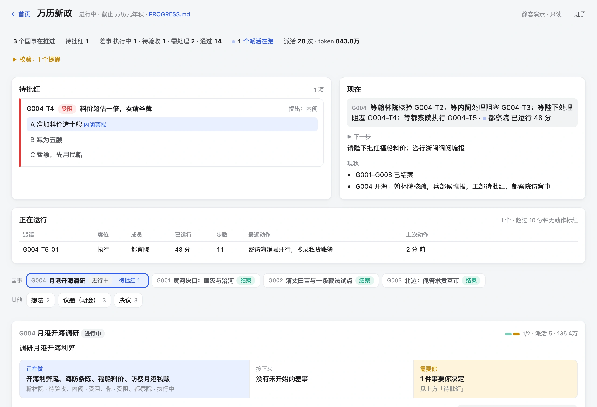
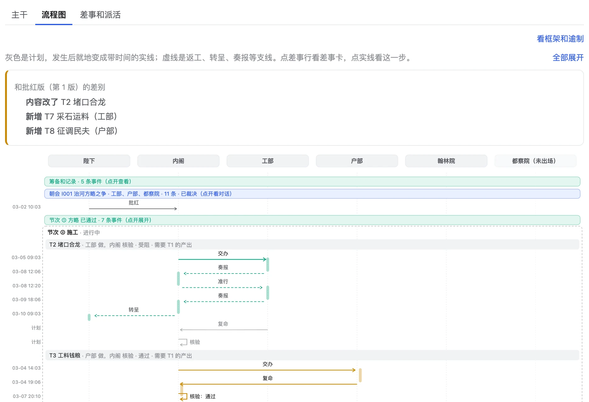
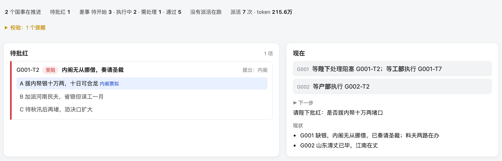
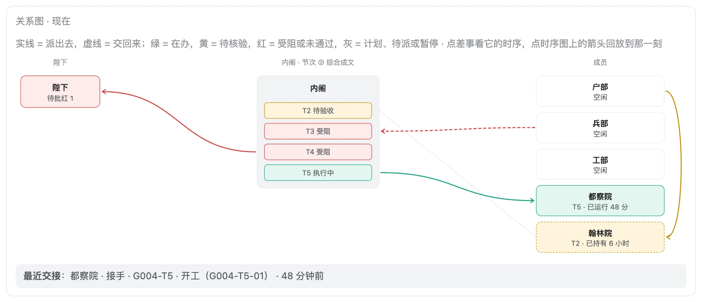
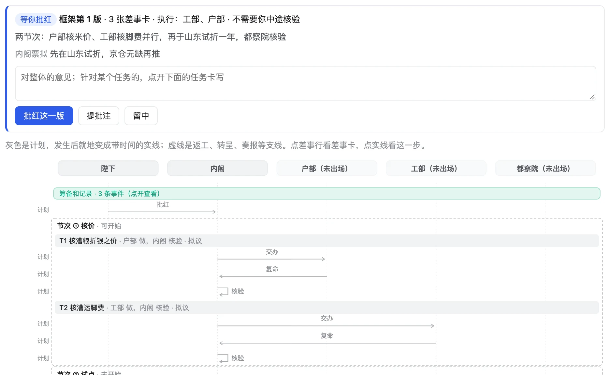
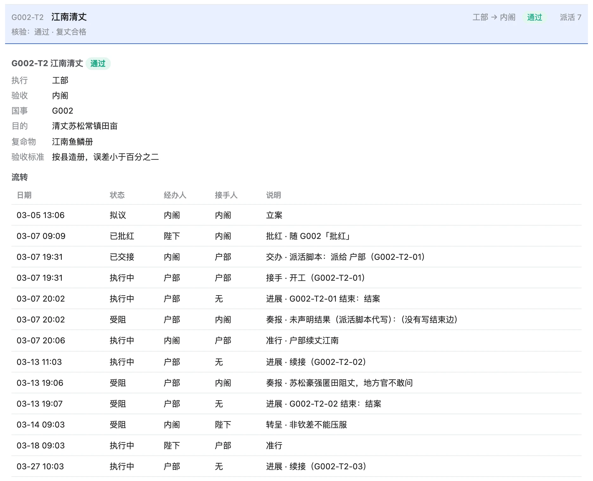
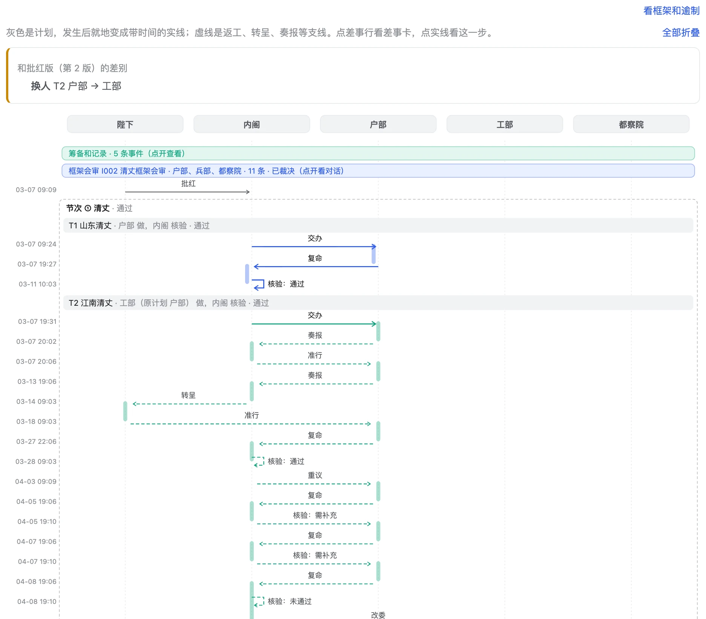
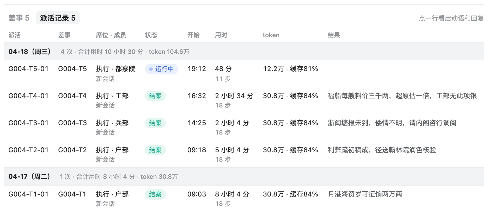
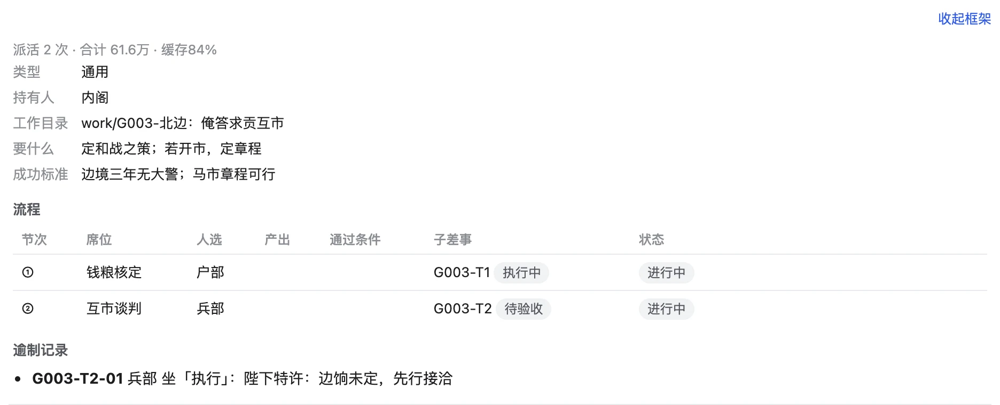

<div align="center">

# 批红（collab）

**中文** · [English](README.en.md)

**AI 票拟，你来批红。**

把 Claude、Codex、DeepSeek 组织成一个小班子，替你推进持续几周的真实项目。<br>
你只做三件事：定目标、批准方案、在关键处拍板。

**[产品站 collab.hongyangz.top](https://collab.hongyangz.top/)** · **[直接进入演示看板](https://collab.hongyangz.top/demo/ch8/p/15730301/)** · **[从第一回看起](https://collab.hongyangz.top/demo/)**

[](https://collab.hongyangz.top/demo/ch8/p/15730301/)

<sub>一屏看完：要你拍板的事、谁在做什么、哪个派活在跑。动画和可交互的完整版见产品站。</sub>

</div>

---

## 一、Claude、Codex 管的是对话，批红管的是事

直接用 Claude、Codex 推进一件持续几周的事，很快你就成了传话筒：

- **传话**：让一个模型出方案，复制给另一个写代码，再把结果贴回来看。
- **失忆**：换个会话背景要重讲一遍，昨天谈定的事今天不知道。
- **自证**：同一个模型出方案、执行、验收，没有第二双眼睛。

问题不在模型不够强，而在结构：它们是 **项目 → 对话**，批红是 **项目 → 目标 → 任务**。

**Claude / Codex：项目 → 对话**，结论散在聊天记录里，谁做了什么、做到哪，只有你记得。

```
我的项目
├─ 💬 帮我出个登录功能的方案
├─ 💬 按这个方案写代码（从上一个对话复制过来）
├─ 💬 接着昨天的继续……（背景重讲一遍）
└─ 💬 你再检查一遍有没有问题？
```

**批红：项目 → 目标 → 任务**，每张卡写明要什么、谁做、谁验、做到哪；换模型、换会话，都从「▶ 下一步」接着做。

```
我的项目
├─ G001 上线登录功能                       【你已批准】
│  ├─ T1 定方案      Claude 做 · Codex 审   【通过】
│  ├─ T2 写代码      Codex 做 · Claude 验   【执行中】
│  └─ T3 端到端验收  DeepSeek 验            【未开始】
└─ G002 改版首页                           【待你批准】
```

| | 直接用 Claude / Codex | 用批红 |
|---|---|---|
| 工作单位 | 一次对话 | 一个目标，拆成几张任务卡 |
| 规划和选人 | 怎么拆、派给谁，全靠你自己想 | 总管搭框架、按能力表选人，你批一次就开工 |
| 工作区 | 产出散在聊天里，草稿和成品混在一起 | `collab/` 记账，`work/` 放成果：每张任务一份交付，每个成员一个工位 |
| 跨会话记忆 | 留在聊天记录里，换会话要重讲 | 写在 `collab/`，各模型共用一份现状，从「▶ 下一步」接着做 |
| 几个模型配合 | 你在窗口之间复制粘贴 | 总管派活，成员在各自命令行里做，结果自动记账 |
| 谁来找你 | 每做完一步都回来问你 | 总管对接成员，框架内的事自己解决；真卡住才上报，附选项和建议 |
| 多模型讨论 | 你轮流去问、来回转述 | 朝会：各自独立发言、会审方案，你来裁决，原文存档 |
| 谁说做完了 | 干活的模型自己说 | 另一个模型按成功标准验收，不过就退回 |
| 你要管什么 | 每一步都得盯着 | 只做三件事：批框架、拍板「待你决定」、确认完成 |
| 进度和花费 | 翻聊天记录 | 看板一眼看清：谁在做、卡在哪、花了多少 token |

## 二、四百多年前的答案

明朝内阁先拟意见写在小票上（票拟），皇帝用朱笔只做决定（批红），六部执行，御史核验。批红把这套分工搬到 AI 身上：

| 席位 | 明朝 | 谁来坐 | 做什么 |
|---|---|---|---|
| **总裁** | 皇帝批红 | **你** | 定目标、批准框架、在「待你决定」里拍板 |
| 总管 | 内阁票拟 | 主力助手（如 Claude） | 拆目标、搭流程、派活、整合成果 |
| 成员 | 六部 | Codex、DeepSeek…… | 在自己的原生命令行里完成任务 |
| 验收 | 给事中封驳 | 另一个模型 | 对照成功标准核验，不达标就退回 |

成员表记着每个模型的档位和成本：难的给强模型，整理、检索这类杂活给便宜的；同一个目标里尽量续接成员原来的会话，不必每次从头讲。

## 三、一件事怎么走完

从一句想法到验收归档，八步里你只出现三次。其余由总管和成员接力，卡住了才来找你。

| 步 | 谁 | 做什么 |
|---|---|---|
| 1 提想法 | **你** | 一句话说要什么 |
| 2 写方案 | 总管 | 要紧的开朝会会审 |
| 3 搭框架 | 总管 | 拆任务、定人选 |
| 4 批红 | **你** | 批了才能开工 |
| 5 干活 | 成员 | 成员各自动手，交付进 `work/` |
| 6 互验 | 成员 | 换个模型验收，不过就退回 |
| ↳ 待你决定 | **你** | 只在卡住时出现，附选项、代价和建议 |
| 7 汇报 | 总管 | 整合成果，交目标验收 |
| 8 确认 | **你** | 你点头，归档 |

## 四、真实案例：一件事卡住了，会发生什么

下面的截图都来自演示「万历新政」，点图进到那一刻的看板。

**1. 受阻了，内阁自己接住。** 工部奏报「合龙要石料和民夫两件，本部只能办料」。内阁判断框架内能解决，不惊动陛下：拆成采石（工部）、征夫（户部）两路并行，原差事改为汇总合龙。流程图上标出了和批红版的差别。

[](https://collab.hongyangz.top/demo/ch3/p/15730301/?view=flow#G001)

**2. 解决不了，才来找你。** 紧接着工部又缺银十万两，内阁无从挪借，这才转呈陛下：三个选项、各自代价、内阁票拟写清楚，你朱批一下就继续。

[](https://collab.hongyangz.top/demo/ch3/p/15730301/#G001)

**3. 朝会：三轮把分歧谈成折中。** 治河之争：第一轮工部、户部、都察院各自独立陈述；第二轮互相质询，户部问银子从哪来，工部翻出嘉靖年间三次分流三次复决；第三轮你一句追问，工部让步提出分两年筑堤。内阁总结，你朱批定案。

[](https://collab.hongyangz.top/demo/ch1/p/15730301/meet/I001/)

**4. 异议留档，私下进言只给你看。** 和战之议：兵部按工部算的账改方案，户部算出三年净省八十万两；都察院接受限数，但坚持把异议原文载入奏疏，还私下提醒「边将私市已久，马数未必可信」，这条只有你和内阁看得到。

[](https://collab.hongyangz.top/demo/ch5/p/15730301/meet/I003/)

**5. 一眼看清，现在谁在做什么。** 开海五路并行：翰林院在核验户部的利弊疏，兵部、工部受阻，其中料价一事已转呈你，都察院的派活正在跑。实线派出，虚线交回，颜色是状态。

[](https://collab.hongyangz.top/demo/ch8/p/15730301/?view=flow#G004)

## 五、功能一览

看板上的每个画面，都是从项目里的 Markdown 和事件记录当场生成的。

| | |
|---|---|
| [](https://collab.hongyangz.top/#features)<br>**开工前，先看图再批红**<br>框架提交后，看板上就是一整张计划图。你可以提批注、留中退回；点「批红这一版」才能开工。批准后存一份批准版，之后图上标出实际和它的差别。 | [](https://collab.hongyangz.top/demo/ch7/p/15730301/#G002)<br>**每张任务卡都有完整流转**<br>目的、交付物、验收标准写在卡上；谁派的、谁接的、何时受阻、为何转呈、哪次续接，一条条记在流转表里。 |
| [](https://collab.hongyangz.top/demo/ch7/p/15730301/?view=flow#G002)<br>**时序图：计划变实线，返工和换人都在线上**<br>证据推翻前提时重议，后续节次自动失效；两次需补充仍不合格，到了返工上限，内阁改委他人。 | [](https://collab.hongyangz.top/demo/ch8/p/15730301/#G004)<br>**每次派活：用时、步数、token**<br>派活脚本启动成员、续接会话、记账；哪次在跑、跑了多久、花了多少 token、交回来一句什么，按天汇总。 |
| [](https://collab.hongyangz.top/demo/ch5/p/15730301/?view=flow#G003)<br>**偏离流程可以，但要留痕**<br>特殊情况可以越过流程顺序，但必须写明理由，看板标为「逾制」。没批准就开工这一条，任何人都越不过。 | [](https://collab.hongyangz.top/demo/ch8/p/15730301/#ideas)<br>**每个想法，先立案**<br>随口一句「考成法」「漕粮改折」，总管也各立一张卡；起草中的按想法、讨论、方案分组，不占进行中的名额。 |

**规则由程序把关，不靠 AI 自觉。** 所有流转只能经 `flow.py` 写入，写入时检查顺序、人选、依赖和批准，不合规当场拒绝；校验出错、交接没写，派活脚本直接不派；Claude Code 每轮结束时自动校验，有错误就不让这一轮结束。

```text
$ flow.py 记 G006-T1 派发 --给 户部 --越过 "急"
硬错误：G006-T1 还在规划中：目标 G006 批准后才能开工，这一步不能越过

$ flow.py 记 G004-T3 派发 --给 兵部
规则错误：G004-T3 现在是「受阻」，不能走「派发」（只能从 已批准）
总管或总裁确需这样做，加 --越过 "理由"；看板会标为偏离。
```

**还有：** 全是本地文件，项目里多一个 `collab/`，Markdown 和 JSON，git 可管，不要数据库、账号或云服务；决议单独成册，朝会裁决自动记入；完成的目标进归档页；可选的 NOW 总看板把多个项目和你的日程放在一页；成员都在 Claude Code、Codex CLI 等自己的命令行里干活，批红不重写 agent。

## 六、万历新政：八回演示

不用安装。演示设在万历元年，你是皇帝；每一回都是同一个项目停在某一刻的真实看板，每条事件都走工具包真实的写入路径。全部是虚拟数据，没有真的派活或调用模型，它也是工具包最大的一组回归测试。

| 回 | 看什么 |
|---|---|
| [第一回 · 先批准，再开工](https://collab.hongyangz.top/demo/ch1/p/15730301/#G001) | 框架没有批红，谁都不能开工；赈灾诏四易其稿 |
| [第二回 · 多个模型会审框架](https://collab.hongyangz.top/demo/ch2/p/15730301/meet/I002/) | 都察院的质疑改变了框架；内阁框架内拆差 |
| [第三回 · 只管需要你决定的事](https://collab.hongyangz.top/demo/ch3/p/15730301/#G001) | 缺银十万两，选项、代价、票拟写清楚 |
| [第四回 · 朱批之后自动续工](https://collab.hongyangz.top/demo/ch4/p/15730301/#G002) | 奏本消失，工部续工；江南阻丈又一道 |
| [第五回 · 你主持的朝会](https://collab.hongyangz.top/demo/ch5/p/15730301/meet/I003/) | 中途加人、私下进言；留中退回；逾制先行 |
| [第六回 · 第三方验收才算完](https://collab.hongyangz.top/demo/ch6/p/15730301/#G001) | 都察院巡按核验，河工告成结案 |
| [第七回 · 证据推翻前提，流程自动回退](https://collab.hongyangz.top/demo/ch7/p/15730301/#G002) | 后续节次失效；返工到上限，改委工部 |
| [终回 · 一眼看清谁在做什么](https://collab.hongyangz.top/demo/ch8/p/15730301/#G004) | 开海五路并行；新想法先立案 |

剧情和每回的看点见 [demo/剧本.md](demo/剧本.md)。

## 七、远景：和 AI 打交道的下一种方式

今天我们一句句地和 AI 聊天。我们想要的是：你只和一个总管谈「要什么」，其余由它去组织人手、推进、交付。

1. **以目标为单位，只做顶层对话。** 每个项目从目标出发。你和总管讨论的是要什么、成功标准、方案取舍，最后看交付、做验收；拆任务、派人、盯进度、返工，由总管自行组织完成。
2. **人才市场：把好用的配置封装成专员。** 一套被你或大家反复用过、验证过的配置，包括身份设定、skill、MCP 工具、权限边界，以及擅长什么、档位和成本、过往战绩，打包成一个「专员」，可以分享、可以复用。
3. **总管按目标组班子。** 立了目标，总管去人才市场挑合适的专员，组成这件事的班子：难活找强的，杂活找便宜的，再配一位挑刺的审查。事情办完班子解散，好用的专员留下口碑。

**现在走到哪：** 目标、任务、批准、派活、验收、朝会这条主线已经能用（就是上面的演示）；班子配置已可用，看板里有人才市场的雏形，还在用示例数据。专员的封装、分享和口碑，是接下来要做的。

## 八、上手

需要 Python 3（只用标准库）和 git，目前在 macOS 上使用。

**先在本机看演示**（克隆本仓库后，在仓库根目录运行）：

```bash
python3 demo/build.py
python3 src/board/server.py --port 3101 --project demo/万历新政
```

打开 http://127.0.0.1:3101 ，看板可以真的批红、在朝会里发言。英文版演示：`python3 demo/build.py --lang en`，再把 `--project` 换成 `demo/wanli-reforms`。

**用到自己的项目（核心三步）：**

```bash
src/core/publish.sh ~/批红/系统                  # 1. 把工具包发布成一份独立拷贝
bash ~/批红/系统/board/service.sh install        # 2. 看板开机常驻（端口 3100）
cd <项目目录> && ~/批红/系统/core/init.sh new --lang zh   # 3. 给项目装上中文工作台（AGENTS.md + collab/）
```

项目会自动登记到看板，http://127.0.0.1:3100 首页列出所有项目。然后让总管按 `collab/PROGRESS.md` 立第一个目标。NOW 总看板、派活和班子配置等，详见 [src/README.md](src/README.md)「快速开始」。

```
src/      工具包：流转引擎 flow.py、派活脚本、校验器、看板服务、装进项目的工作台
tests/    测试和期望输出
demo/     演示「万历新政」：剧本、生成脚本、静态站生成
```

全量测试：`python3 -m unittest discover -s tests`。

## 九、常见问题

<details><summary><b>支持哪些模型？</b></summary>

总管通常是 Claude（Claude Code 或桌面版）；成员可以是 Codex CLI、DeepSeek、Claude 命令行等任何能在终端里跑的助手。成员在自己的原生命令行里干活，批红不替换它们。
</details>

<details><summary><b>数据存在哪？要上传吗？</b></summary>

全在项目目录的 `collab/` 和 `work/` 里，Markdown 和 JSON；看板跑在本机。批红本身不上传任何东西，模型调用照各自工具的方式联网。
</details>

<details><summary><b>要花多少钱？</b></summary>

批红开源免费（MIT）。费用来自你用的模型：看板记下每次派活的 token 和缓存命中，总管按难度和成本选人，杂活交给便宜的模型。
</details>

<details><summary><b>和多智能体框架有什么区别？</b></summary>

多智能体框架在代码里编排几个 agent 互相对话；批红不写 agent、不编排对话，它管的是项目账本、流程、批准和验收，agent 用你已有的命令行工具。
</details>

<details><summary><b>支持哪些语言？</b></summary>

中文和英文。给项目装工作台时选（`--lang zh` 或 `--lang en`），规则、模板和提示都跟着走；已有项目用 `init.sh lang zh|en` 切换。两种语言底层的文件名和编号都是英文。看板顶上有 中 / EN 切换。
</details>

<details><summary><b>支持哪些系统？</b></summary>

目前只在 macOS 上用过；需要 Python 3（只用标准库）和 git。
</details>

<details><summary><b>小事也要用吗？</b></summary>

不用。一次性的小问题直接聊天更快；批红适合持续几天到几周、要分阶段推进、想让几个模型互相检查的事。
</details>

## 这还是一个 demo

批红目前只是一个演示版本，还需要进一步优化和组织，才能真正实现上面的想法。欢迎分享你自己的「班子」：你常用哪些模型、怎么分工、哪位专员最好用，也欢迎任何改进想法和吐槽。

- 邮件：[hongyang003@e.ntu.edu.sg](mailto:hongyang003@e.ntu.edu.sg)
- 或者直接提 issue、PR

## 状态和许可

早期版本：接口和文件格式还会变；统一的 `collab` 命令还在做。文档有中文和英文。[MIT](LICENSE) 许可。
